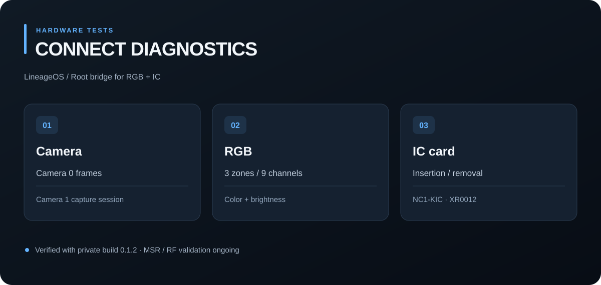

# Connect 診断

[한국어](README.ko.md) · [English](README.md)



LineageOS をインストールした Naver Pay Connect（Npay_connect）で、カメラ、音声、センサー、Android NFC、RGB、IC カードの状態を確認するアプリです。

| 機能 | 実機で確認した範囲 |
| --- | --- |
| カメラ | ID 0 の映像フレームと ID 1 のキャプチャセッション開始を確認しました。 |
| RGB | root ブリッジで 3 か所の RGB 9 チャンネルを制御し、テスト前の明るさに戻しました。 |
| IC カード | NC1-KIC ファームウェア XR0012 で挿入と取り外しを確認しました。 |
| MSR | 実験用の待機処理の終了と UART ロックの解放を確認しました。実際のスワイプは未検証です。 |
| 決済用 NFC | RF検出は追加検証中です。通常モードへの復帰を確認しました。アプリの Android NFC は別の標準 API を使用します。 |

実機試験にはプライベートビルド 0.1.2 を使用しました。公開版はシステムフォントを使います。APK のビルドと署名は確認済みで、公開版の実機インストールは未検証です。

## Windows でのビルド

PowerShell、JDK 21、Android SDK Platform 36、Build Tools 36.0.0、Platform Tools が必要です。JAVA_HOME と ANDROID_HOME を設定し、adb を PATH に追加します。ビルドに `-Sdk` と `-Jdk` を指定することもできます。

```powershell
./connect-diagnostics/build.ps1
./hardware-bridge/build.ps1
adb -s <接続ID> install -r ./connect-diagnostics/build/ConnectDiagnostics-0.1.2-public.apk
```

ビルド時にローカル署名鍵を生成します。上書きインストールには元の APK と同じ鍵が必要です。鍵の変更のためにアンインストールするとアプリデータも消去されます。公開ソースからAPKをビルドできます。生成した署名鍵は次回の更新用に保管してください。

## RGB と IC のサービスを開始

```powershell
adb -s <接続ID> root
adb devices
./hardware-bridge/start-bridge.ps1 -Serial <現在の接続ID>
```

ブリッジは診断アプリと、インストールされている場合はコンソールアプリの UID を許可します。端末を再起動した後は再度起動します。停止には `-Stop` を指定します。起動スクリプトは SELinux モードを維持します。

UART デバイスファイルが存在しない場合は、次のコマンドで復元してファームウェアを確認します。

```powershell
python ./hardware-bridge/card_probe.py --serial <現在の接続ID> --repair-node firmware
```

実験用 MSR と RF ツールは [hardware-bridge の説明](hardware-bridge/README.md)を参照してください。

両方のアプリを使う場合は `naver-connect-diagnostics` の補助サービスを起動してください。RGBとICを提供します。コンソール専用サービスはRGBのみです。同じRGBソケットを使うため、切り替え前に既存サービスを `-Stop` で停止します。起動スクリプトはRGB・ICソケットを確認してから準備完了を表示します。公開用スクリプトは構文確認済みで、実機実行の確認待ちです。
