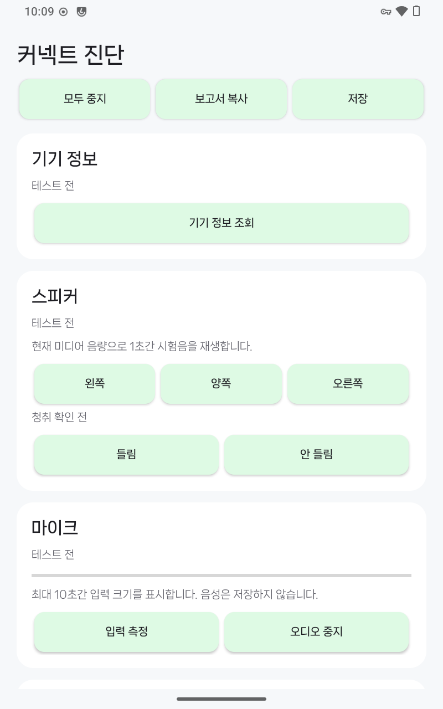

# 커넥트 진단

[English](README.md) · [日本語](README.ja.md)



LineageOS를 설치한 네이버페이 커넥트(Npay_connect)에서 카메라, 오디오, 센서, Android NFC, RGB와 IC 카드 상태를 확인하는 앱입니다.

| 기능 | 실기 확인 범위 |
| --- | --- |
| 카메라 | ID 0 영상 프레임과 ID 1 캡처 세션 시작을 확인했습니다. |
| RGB | root 보조 서비스로 세 구역의 RGB 9채널을 제어하고 테스트 전 밝기를 복원했습니다. |
| IC 카드 | NC1-KIC 펌웨어 XR0012에서 실제 삽입과 제거를 확인했습니다. |
| MSR | 실험용 수신 대기 종료와 UART 잠금 해제를 확인했습니다. 실제 카드 스와이프 확인은 남았습니다. |
| 결제 NFC | RF 감지는 추가 검증 중입니다. 조회 후 모듈의 정상 모드 복귀를 확인했습니다. 앱의 Android NFC 테스트는 표준 API를 사용합니다. |

실기 시험에는 개인 빌드 0.1.2를 사용했습니다. 공개 빌드는 시스템 글꼴을 사용하며 APK 빌드와 서명을 확인했습니다. 공개 APK의 실기 설치는 미검증입니다.

## Windows 빌드

PowerShell, JDK 21, Android SDK Platform 36, Build Tools 36.0.0, Platform Tools가 필요합니다. JAVA_HOME과 ANDROID_HOME을 지정하고 adb를 PATH에 추가합니다. 필요하면 빌드에 `-Sdk`, `-Jdk`를 직접 전달할 수 있습니다.

```powershell
./connect-diagnostics/build.ps1
./hardware-bridge/build.ps1
adb -s <연결-ID> install -r ./connect-diagnostics/build/ConnectDiagnostics-0.1.2-public.apk
```

빌드 시 로컬 서명 키가 생성됩니다. 기존 APK를 덮어쓰려면 같은 키가 필요합니다. 다른 키로 교체하기 위해 앱을 삭제하면 앱 데이터도 삭제됩니다. 소스를 내려받아 APK를 빌드할 수 있습니다. 생성한 서명 키는 다음 업데이트를 위해 보관하세요.

## RGB 및 IC 서비스 시작

```powershell
adb -s <연결-ID> root
adb devices
./hardware-bridge/start-bridge.ps1 -Serial <현재-연결-ID>
```

보조 서비스는 설치된 진단 앱과, 설치되어 있으면 콘솔 앱의 UID를 허용합니다. 재부팅 후에는 다시 시작합니다. 종료하려면 `-Stop`을 추가합니다. 시작 스크립트는 현재 SELinux 모드를 유지합니다.

UART 장치 파일이 누락된 경우에만 다음 명령으로 복구하고 모듈 버전을 확인합니다.

```powershell
python ./hardware-bridge/card_probe.py --serial <현재-연결-ID> --repair-node firmware
```

MSR 및 RF 실험 도구는 [hardware-bridge 안내](hardware-bridge/README.md)를 참고하세요.

두 앱을 함께 사용하면 `naver-connect-diagnostics`의 보조 서비스를 시작하세요. 이 서비스는 RGB와 IC를 제공하고 콘솔 전용 서비스는 RGB만 제공합니다. 같은 RGB 소켓을 공유하므로 기존 서비스를 `-Stop`으로 종료한 뒤 바꿉니다. 시작 스크립트는 RGB·IC 소켓을 확인한 뒤 준비 완료를 표시합니다. 공개용 스크립트의 검증 상태는 구문 검사 완료, 실기 실행 확인 대기입니다.
