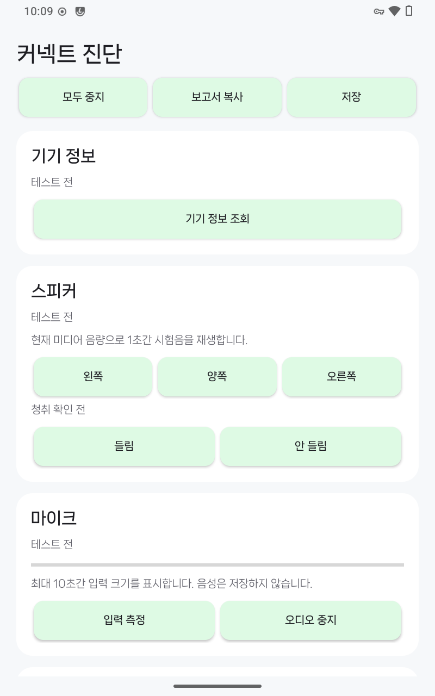

# Connect Diagnostics

[한국어](README.ko.md) · [日本語](README.ja.md)



Android diagnostics for Naver Pay Connect (Npay_connect) running LineageOS. The app provides camera, audio, sensors, Android NFC, RGB, and IC card status tests.

| Feature | Verification on the test device |
| --- | --- |
| Camera | Camera 0 delivered frames. Camera 1 opened a capture session. |
| RGB | The local root bridge controlled nine visible LED channels across three zones. The test restored the previous brightness. |
| IC card | Insertion and removal were confirmed on NC1-KIC firmware XR0012 with the root bridge. |
| MSR | The experimental passive listener stopped and released the UART. A physical swipe remains unverified. |
| Payment NFC | RF detection remains under investigation. The reader returned to production mode. Android NFC in the app uses a separate platform API. |

Testing used the private 0.1.2 APK. The public source builds with system fonts. Its APK was built and its signature checked locally. Device installation of this public build remains unverified.

## Build on Windows

Use PowerShell, JDK 21, Android SDK Platform 36, Build Tools 36.0.0, and Android Platform Tools. Set JAVA_HOME and ANDROID_HOME and put adb on PATH, or pass the paths explicitly.

```powershell
./connect-diagnostics/build.ps1
./hardware-bridge/build.ps1
adb -s <transport> install -r ./connect-diagnostics/build/ConnectDiagnostics-0.1.2-public.apk
```

The build creates a local signing key. Updating an existing APK in place requires a matching signing key. Uninstalling an APK to change keys removes its app data. Build the APK from the supplied source and retain your signing key for future updates.

## Start RGB and IC access

```powershell
adb -s <transport> root
adb devices
./hardware-bridge/start-bridge.ps1 -Serial <current-transport>
```

The bridge allows the installed diagnostics app and optionally the console app by UID. Run the start script after a device reboot and add `-Stop` to stop the service. If the UART device node is missing, use the explicit repair option below. The launcher keeps the current SELinux mode.

```powershell
python ./hardware-bridge/card_probe.py --serial <current-transport> --repair-node firmware
```

The experimental host MSR and RF probes are in [hardware-bridge](hardware-bridge/README.md).

When both apps are used, start the helper from `naver-connect-diagnostics`: it provides RGB and IC. The console-only helper provides RGB. Only one helper can bind the shared RGB socket; stop an older helper before switching. The launcher checks both RGB and IC sockets before reporting readiness. Public startup-script validation: syntax checks completed; hardware execution pending.
